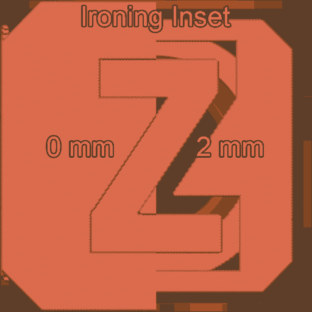

# ironing_inset

> Location: Process → Quality → Ironing → Inset

---

[Mode](../../../general_settings/option_mode.md): `Advanced`.  
[Variable](../../../developer_reference/built_in_placeholders_variables.md): `ironing_inset`.  
[Type](../../../general_settings/option_type.md#integer-float-percentage): `Float`.  
[Default](../../../general_settings/option_type.md#default-value): `0`.  
[Unit](../../../general_settings/option_type.md#unit): `mm`.  
[Range](../../../general_settings/option_type.md#range): `[0, 100]`.  
[CLI Example](../../../cli/cli_mode.md#setting-overrides): `--ironing-inset=1`.  

The distance to keep from the edges, which can help prevent over-extrusion at the edges of the surface being ironed.

If this value is set to 0, an inset of half the nozzle diameter is used, so the [ironing pattern](ironing_pattern.md) stays slightly inside the outer boundaries of the top surface being ironed.
