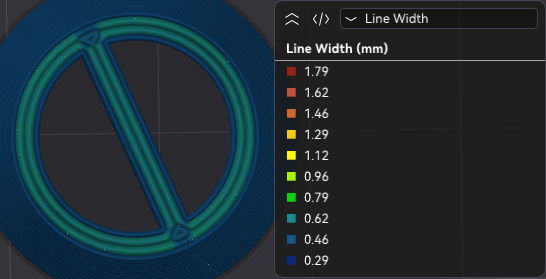

# min_bead_width

> Location: Process → Quality → Wall generator → Minimum wall width
> Also in this section: `wall_transition_angle`, `wall_transition_filter_deviation`, `wall_transition_length`, `wall_distribution_count`, `initial_layer_min_bead_width`, `min_feature_size`, `min_length_factor` (each documented on its own page).

---

[Mode](../../../general_settings/option_mode.md): `Advanced`.  
[Variable](../../../developer_reference/built_in_placeholders_variables.md): `min_bead_width`.  
[Type](../../../general_settings/option_type.md#integer-float-percentage): `Percentage`.  
[Default](../../../general_settings/option_type.md#default-value): `85`.  
[Unit](../../../general_settings/option_type.md#unit): `%`.  
[Range](../../../general_settings/option_type.md#range): `≥ 0`.  
[CLI Example](../../../cli/cli_mode.md#setting-overrides): `--min-bead-width=value`.  

Width of the wall that will replace thin features (according to the Minimum feature size) of the model. If the Minimum wall width is thinner than the thickness of the feature, the wall will become as thick as the feature itself. It's expressed as a percentage over nozzle diameter.

## Arachne

The Arachne wall generator dynamically adjusts extrusion width to follow the shape of the model more closely. This allows better handling of thin features and smooth transitions between wall counts.

> [!NOTE]
> [A Framework for Adaptive Width Control of Dense Contour-Parallel Toolpaths in Fused Deposition Modeling](https://www.sciencedirect.com/science/article/pii/S0010448520301007?via%3Dihub)
