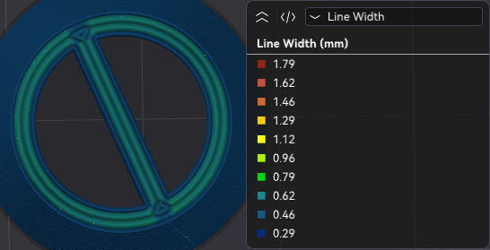

# min_length_factor

> Location: Process → Quality → Wall generator → Minimum wall length
> Also in this section: `wall_transition_angle`, `wall_transition_filter_deviation`, `wall_transition_length`, `wall_distribution_count`, `initial_layer_min_bead_width`, `min_bead_width`, `min_feature_size` (each documented on its own page).

---

[Mode](../../../general_settings/option_mode.md): `Advanced`.  
[Variable](../../../developer_reference/built_in_placeholders_variables.md): `min_length_factor`.  
[Type](../../../general_settings/option_type.md#integer-float-percentage): `Float`.  
[Default](../../../general_settings/option_type.md#default-value): `0.5`.  
[Unit](../../../general_settings/option_type.md#unit): `mm`.  
[CLI Example](../../../cli/cli_mode.md#setting-overrides): `--min-length-factor=1`.  

Adjust this value to prevent short, unclosed walls from being printed, which could increase print time. Higher values remove more and longer walls.\n\nNOTE: Bottom and top surfaces will not be affected by this value to prevent visual gaps on the outside of the model. Adjust 'One wall threshold' in the Advanced settings below to adjust the sensitivity of what is considered a top-surface. 'One wall threshold' is only visible if this setting is set above the default value of 0.5, or if single-wall top surfaces is enabled.

## Arachne

The Arachne wall generator dynamically adjusts extrusion width to follow the shape of the model more closely. This allows better handling of thin features and smooth transitions between wall counts.

> [!NOTE]
> [A Framework for Adaptive Width Control of Dense Contour-Parallel Toolpaths in Fused Deposition Modeling](https://www.sciencedirect.com/science/article/pii/S0010448520301007?via%3Dihub)
