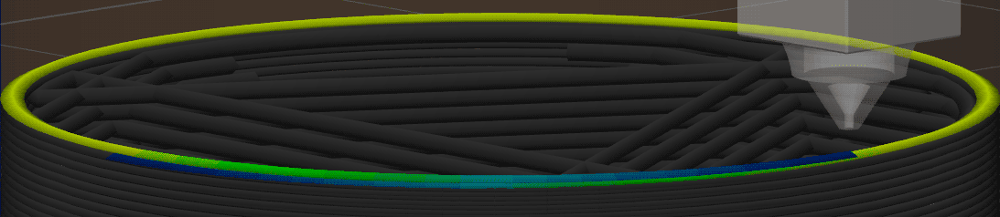

# scarf_angle_threshold

> Location: Process → Quality → Seam → Conditional angle threshold
> Also in this section: `seam_slope_type`, `seam_slope_conditional`, `scarf_overhang_threshold`, `scarf_joint_speed`, `seam_slope_start_height`, `seam_slope_entire_loop`, `seam_slope_min_length`, `seam_slope_steps`, `scarf_joint_flow_ratio`, `seam_slope_inner_walls` (each documented on its own page).

---

[Mode](../../../general_settings/option_mode.md): `Advanced`.  
[Variable](../../../developer_reference/built_in_placeholders_variables.md): `scarf_angle_threshold`.  
[Type](../../../general_settings/option_type.md#integer-float-percentage): `Integer`.  
[Default](../../../general_settings/option_type.md#default-value): `155`.  
[Unit](../../../general_settings/option_type.md#unit): `°`.  
[Range](../../../general_settings/option_type.md#range): `[0, 180]`.  
[CLI Example](../../../cli/cli_mode.md#setting-overrides): `--scarf-angle-threshold=1`.  

This option sets the threshold angle for applying a conditional scarf joint seam.\nIf the maximum angle within the perimeter loop exceeds this value (indicating the absence of sharp corners), a scarf joint seam will be used. The default value is 155°.

### Scarf joint seam

[Mode](../../../general_settings/option_mode.md): `Advanced`.  
[Variable](../../../developer_reference/built_in_placeholders_variables.md): `scarf_angle_threshold`.  

Adjusts the extrusion flow rate at seam points to create a smooth overlap between the start and end of each loop, minimizing visible defects.

Advantages:

- Reduces visible z-seams
- Improves cosmetic quality of curved surfaces
- Can slightly improve part strength at seams by softening transitions

Disadvantages:

- May increase print time slightly
- Less effective on sharp corners and overhangs
- Requires tuning of parameters like length, speed, and flow for best results

Scarf joints are never applied on the first layer, in [spiral vase](../../process/others/spiral_mode.md) mode, or on belt printers.

> [!NOTE]
> Read more here: [Better Seams - An OrcaSlicer Guide](https://www.printables.com/model/783313-better-seams-an-orca-slicer-guide-to-using-scarf-s).
