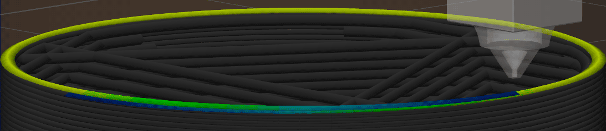

# scarf_joint_speed

> Location: Process → Quality → Seam → Scarf joint speed
> Also in this section: `seam_slope_type`, `seam_slope_conditional`, `scarf_angle_threshold`, `scarf_overhang_threshold`, `seam_slope_start_height`, `seam_slope_entire_loop`, `seam_slope_min_length`, `seam_slope_steps`, `scarf_joint_flow_ratio`, `seam_slope_inner_walls` (each documented on its own page).

---

[Mode](../../../general_settings/option_mode.md): `Advanced`.  
[Variable](../../../developer_reference/built_in_placeholders_variables.md): `scarf_joint_speed`.  
[Type](../../../general_settings/option_type.md#integer-float-percentage): `Float or Percentage`.  
[Default](../../../general_settings/option_type.md#default-value): `100%`.  
[Unit](../../../general_settings/option_type.md#unit): `mm/s or %`.  
[Range](../../../general_settings/option_type.md#range): `≥ 1`.  
[CLI Example](../../../cli/cli_mode.md#setting-overrides): `--scarf-joint-speed=1`.  

This option sets the printing speed for scarf joints. It is recommended to print scarf joints at a slow speed (less than 100 mm/s). It's also advisable to enable 'Extrusion rate smoothing' if the set speed varies significantly from the speed of the outer or inner walls. If the speed specified here is higher than the speed of the outer or inner walls, the printer will default to the slower of the two speeds. When specified as a percentage (e.g., 80%), the speed is calculated based on the respective outer or inner wall speed. The default value is set to 100%.

### Scarf joint seam

[Mode](../../../general_settings/option_mode.md): `Advanced`.  
[Variable](../../../developer_reference/built_in_placeholders_variables.md): `scarf_joint_speed`.  

Adjusts the extrusion flow rate at seam points to create a smooth overlap between the start and end of each loop, minimizing visible defects.

Advantages:

- Reduces visible z-seams
- Improves cosmetic quality of curved surfaces
- Can slightly improve part strength at seams by softening transitions

Disadvantages:

- May increase print time slightly
- Less effective on sharp corners and overhangs
- Requires tuning of parameters like length, speed, and flow for best results

Scarf joints are never applied on the first layer, in [spiral vase](../../process/others/spiral_mode.md) mode, or on [belt printers](../../../guides/belt_printing.md#features-that-are-not-available).

> [!NOTE]
> Read more here: [Better Seams - An OrcaSlicer Guide](https://www.printables.com/model/783313-better-seams-an-orca-slicer-guide-to-using-scarf-s).
