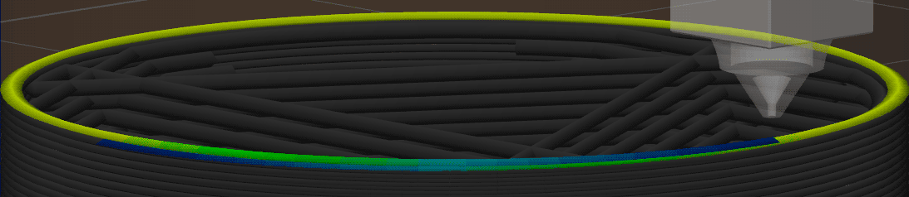

# scarf_overhang_threshold

> Location: Process → Quality → Seam → Conditional overhang threshold
> Also in this section: `seam_slope_type`, `seam_slope_conditional`, `scarf_angle_threshold`, `scarf_joint_speed`, `seam_slope_start_height`, `seam_slope_entire_loop`, `seam_slope_min_length`, `seam_slope_steps`, `scarf_joint_flow_ratio`, `seam_slope_inner_walls` (each documented on its own page).

---

[Mode](../../../general_settings/option_mode.md): `Advanced`.  
[Variable](../../../developer_reference/built_in_placeholders_variables.md): `scarf_overhang_threshold`.  
[Type](../../../general_settings/option_type.md#integer-float-percentage): `Percentage`.  
[Default](../../../general_settings/option_type.md#default-value): `40`.  
[Unit](../../../general_settings/option_type.md#unit): `%`.  
[Range](../../../general_settings/option_type.md#range): `≥ 0`.  
[CLI Example](../../../cli/cli_mode.md#setting-overrides): `--scarf-overhang-threshold=value`.  

This option determines the overhang threshold for the application of scarf joint seams. If the unsupported portion of the perimeter is less than this threshold, scarf joint seams will be applied. The default threshold is set at 40% of the external wall's width. Due to performance considerations, the degree of overhang is estimated.

### Scarf joint seam

[Mode](../../../general_settings/option_mode.md): `Advanced`.  
[Variable](../../../developer_reference/built_in_placeholders_variables.md): `scarf_overhang_threshold`.  

Adjusts the extrusion flow rate at seam points to create a smooth overlap between the start and end of each loop, minimizing visible defects.

Advantages:

- Reduces visible z-seams
- Improves cosmetic quality of curved surfaces
- Can slightly improve part strength at seams by softening transitions

Disadvantages:

- May increase print time slightly
- Less effective on sharp corners and overhangs
- Requires tuning of parameters like length, speed, and flow for best results

Scarf joints are never applied on the first layer, in [spiral vase](../../process/others/spiral_mode.md) mode, or on belt printers.

> [!NOTE]
> Read more here: [Better Seams - An OrcaSlicer Guide](https://www.printables.com/model/783313-better-seams-an-orca-slicer-guide-to-using-scarf-s).
