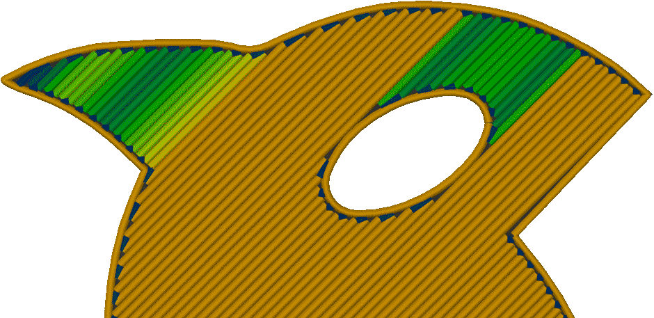

# small_area_infill_flow_compensation

> Location: Process → Quality → Walls and surfaces
> Also in this section: `small_area_infill_flow_compensation_model` (each documented on its own page).

---

## Small area flow compensation

[Mode](../../../general_settings/option_mode.md): `Advanced`.  
[Variable](../../../developer_reference/built_in_placeholders_variables.md): `small_area_infill_flow_compensation`.  
[Type](../../../general_settings/option_type.md): Boolean.  
[Default](../../../general_settings/option_type.md#default-value): `false`.  
[CLI Example](../../../cli/cli_mode.md#setting-overrides): `--small-area-infill-flow-compensation=1`.  

Enables adaptive flow control for small infill areas.
This feature helps address extrusion problems that often occur in small regions of solid infill, such as the tops of narrow letters or fine features.  
In these cases, standard extrusion flow may be too much for the available space, leading to over-extrusion or poor surface quality.

It works by dynamically adjusting the extrusion flow based on the length of the extrusion path, ensuring more precise material deposition in small spaces.

The compensation only applies to internal solid infill, top surfaces and first layer bottom surfaces, and only when that surface uses the [Rectilinear](../../process/strength/sparse_infill_pattern.md), [Aligned Rectilinear](../../process/strength/sparse_infill_pattern.md), [Monotonic](../../process/strength/sparse_infill_pattern.md) or [Monotonic line](../../process/strength/sparse_infill_pattern.md) pattern.

This is a native implementation of @Alexander-T-Moss's [Small Area Flow Compensation](https://github.com/Alexander-T-Moss/Small-Area-Flow-Comp).
