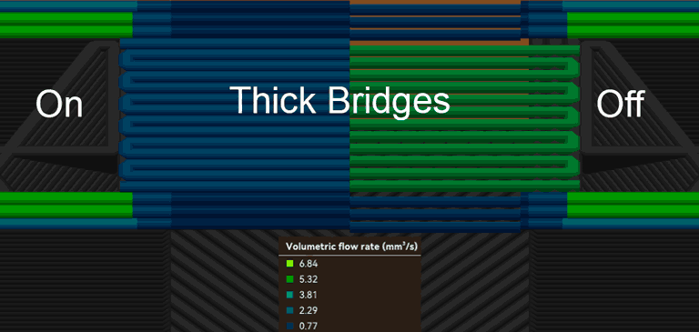

# thick_bridges

> Location: Process → Quality → Bridging → Thick bridges
> Also in this section: `thick_internal_bridges` (each documented on its own page).

---

[Mode](../../../general_settings/option_mode.md): `Advanced`.  
[Variable](../../../developer_reference/built_in_placeholders_variables.md): `thick_bridges`.  
[Type](../../../general_settings/option_type.md#boolean): `Boolean`.  
[Default](../../../general_settings/option_type.md#default-value): `false`.  
[CLI Example](../../../cli/cli_mode.md#setting-overrides): `--thick-bridges=1`.  

When enabled, bridge extrusion uses a line height equal to the nozzle diameter.  
  
This improves the strength and reliability of bridges, allowing you to span longer distances; however, it may produce a rougher surface finish.  
Disabling this option can improve bridge appearance, but it is recommended only for shorter spans or when using large nozzles.  
It's recommended to enable this option for internal bridges, as it increases their reliability when printed over sparse infill.
