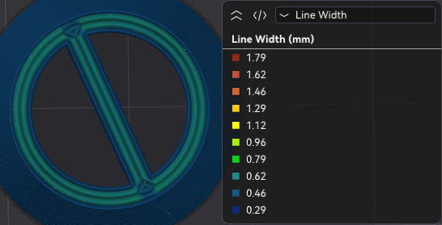

# wall_distribution_count

> Location: Process → Quality → Wall generator → Wall distribution count
> Also in this section: `wall_transition_angle`, `wall_transition_filter_deviation`, `wall_transition_length`, `initial_layer_min_bead_width`, `min_bead_width`, `min_feature_size`, `min_length_factor` (each documented on its own page).

---

[Mode](../../../general_settings/option_mode.md): `Advanced`.  
[Variable](../../../developer_reference/built_in_placeholders_variables.md): `wall_distribution_count`.  
[Type](../../../general_settings/option_type.md#integer-float-percentage): `Integer`.  
[Default](../../../general_settings/option_type.md#default-value): `1`.  
[Range](../../../general_settings/option_type.md#range): `≥ 1`.  
[CLI Example](../../../cli/cli_mode.md#setting-overrides): `--wall-distribution-count=1`.  

The number of walls, counted from the center, over which the variation needs to be spread. Lower values mean that the outer walls don't change in width.

## Arachne

The Arachne wall generator dynamically adjusts extrusion width to follow the shape of the model more closely. This allows better handling of thin features and smooth transitions between wall counts.

> [!NOTE]
> [A Framework for Adaptive Width Control of Dense Contour-Parallel Toolpaths in Fused Deposition Modeling](https://www.sciencedirect.com/science/article/pii/S0010448520301007?via%3Dihub)
