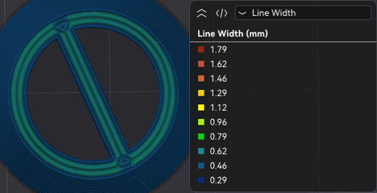

# wall_transition_angle

> Location: Process → Quality → Wall generator → Wall transitioning threshold angle
> Also in this section: `wall_transition_filter_deviation`, `wall_transition_length`, `wall_distribution_count`, `initial_layer_min_bead_width`, `min_bead_width`, `min_feature_size`, `min_length_factor` (each documented on its own page).

---

[Mode](../../../general_settings/option_mode.md): `Advanced`.  
[Variable](../../../developer_reference/built_in_placeholders_variables.md): `wall_transition_angle`.  
[Type](../../../general_settings/option_type.md#integer-float-percentage): `Float`.  
[Default](../../../general_settings/option_type.md#default-value): `10`.  
[Unit](../../../general_settings/option_type.md#unit): `°`.  
[CLI Example](../../../cli/cli_mode.md#setting-overrides): `--wall-transition-angle=1`.  

When to create transitions between even and odd numbers of walls. A wedge shape with an angle greater than this setting will not have transitions and no walls will be printed in the center to fill the remaining space. Reducing this setting reduces the number and length of these center walls, but may leave gaps or overextrude.

## Arachne

The Arachne wall generator dynamically adjusts extrusion width to follow the shape of the model more closely. This allows better handling of thin features and smooth transitions between wall counts.

> [!NOTE]
> [A Framework for Adaptive Width Control of Dense Contour-Parallel Toolpaths in Fused Deposition Modeling](https://www.sciencedirect.com/science/article/pii/S0010448520301007?via%3Dihub)
