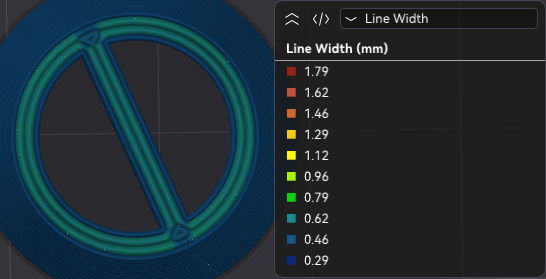

# wall_transition_filter_deviation

> Location: Process → Quality → Wall generator → Wall transitioning filter margin
> Also in this section: `wall_transition_angle`, `wall_transition_length`, `wall_distribution_count`, `initial_layer_min_bead_width`, `min_bead_width`, `min_feature_size`, `min_length_factor` (each documented on its own page).

---

[Mode](../../../general_settings/option_mode.md): `Advanced`.  
[Variable](../../../developer_reference/built_in_placeholders_variables.md): `wall_transition_filter_deviation`.  
[Type](../../../general_settings/option_type.md#integer-float-percentage): `Percentage`.  
[Default](../../../general_settings/option_type.md#default-value): `25`.  
[Unit](../../../general_settings/option_type.md#unit): `%`.  
[Range](../../../general_settings/option_type.md#range): `≥ 0`.  
[CLI Example](../../../cli/cli_mode.md#setting-overrides): `--wall-transition-filter-deviation=value`.  

Prevent transitioning back and forth between one extra wall and one less. This margin extends the range of extrusion widths which follow to [Minimum wall width - margin, 2 * Minimum wall width + margin]. Increasing this margin reduces the number of transitions, which reduces the number of extrusion starts/stops and travel time. However, large extrusion width variation can lead to under- or overextrusion problems. It's expressed as a percentage over nozzle diameter.

## Arachne

The Arachne wall generator dynamically adjusts extrusion width to follow the shape of the model more closely. This allows better handling of thin features and smooth transitions between wall counts.

> [!NOTE]
> [A Framework for Adaptive Width Control of Dense Contour-Parallel Toolpaths in Fused Deposition Modeling](https://www.sciencedirect.com/science/article/pii/S0010448520301007?via%3Dihub)
