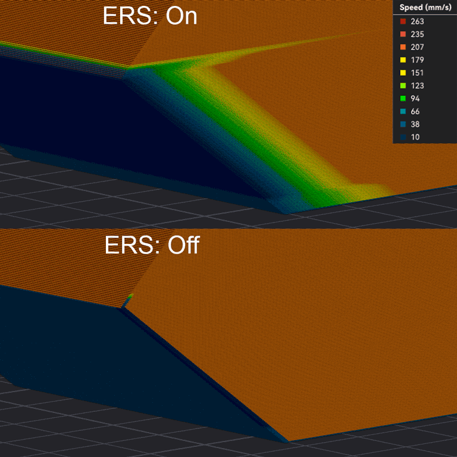

# max_volumetric_extrusion_rate_slope_segment_length

> Location: Process → Speed → Advanced → Speed Advanced - Extrusion Rate Smoothing
> Also in this section: `max_volumetric_extrusion_rate_slope` (each documented on its own page).

---

[Mode](../../../general_settings/option_mode.md): `Advanced`.  
[Variable](../../../developer_reference/built_in_placeholders_variables.md): `max_volumetric_extrusion_rate_slope_segment_length`.  
[Type](../../../general_settings/option_type.md#integer-float-percentage): `Float`.  
[Default](../../../general_settings/option_type.md#default-value): `3`.  
[Unit](../../../general_settings/option_type.md#unit): `mm`.  
[Range](../../../general_settings/option_type.md#range): `≤ 5`.  
[CLI Example](../../../cli/cli_mode.md#setting-overrides): `--max-volumetric-extrusion-rate-slope-segment-length=1`.  

Extrusion Rate Smoothing (ERS) (pressure equalizer in PrusaSlicer) aims to **limit the rate of extrusion volume change to be below a user-set threshold (the ERS value)**.  
It aims to assist the printer firmware's internal motion planner and pressure advance in achieving the desired nozzle flow and reducing deviations from the ideal flow.

This happens by reducing the stresses put on the extrusion system as well as reducing the absolute deviations from the ideal extrusion flow caused by pressure advance smooth time.

This feature is especially helpful when printing at high accelerations and large flow rates as the deviations are larger in these cases.

> [!NOTE]
> A value of 0 disables Extrusion rate smoothing. Any value greater than 0 turns off [Arc fitting](../../process/quality/enable_arc_fitting.md) and locks that option while smoothing is enabled.

- [Apply only on external features](extrusion_rate_smoothing_external_perimeter_only.md)

