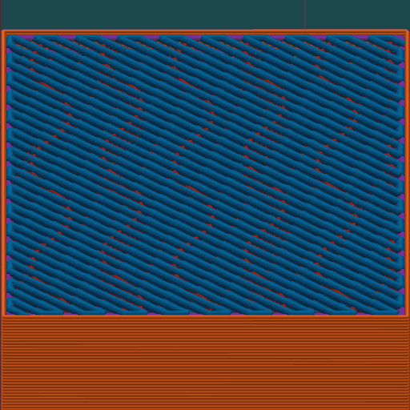

# extra_solid_infills

> Location: Process → Strength → Advanced

---

## Extra Solid Infill

[Mode](../../../general_settings/option_mode.md): `Advanced`.  
[Variable](../../../developer_reference/built_in_placeholders_variables.md): `extra_solid_infills`.  
[Type](../../../general_settings/option_type.md#text): `Text`.  
[Default](../../../general_settings/option_type.md#default-value): `(empty)`.  
[CLI Example](../../../cli/cli_mode.md#setting-overrides): `--extra-solid-infills=value`.  

Insert extra solid infills at specific layers to add strength at critical points in your print. This feature allows you to strategically reinforce your part without changing the overall sparse infill density.

The pattern supports two formats:
