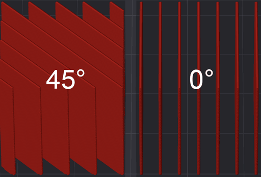

# infill_direction

> Location: Process → Strength → Infill
> Also in this section: `solid_infill_direction` (each documented on its own page).

---

### Direction

[Mode](../../../general_settings/option_mode.md): `Advanced`.  
[Variable](../../../developer_reference/built_in_placeholders_variables.md): `infill_direction`.  
[Type](../../../general_settings/option_type.md#integer-float-percentage): `Float`.  
[Default](../../../general_settings/option_type.md#default-value): `45`.  
[Range](../../../general_settings/option_type.md#range): `0–360` °.  
[CLI Example](../../../cli/cli_mode.md#setting-overrides): `--infill-direction=1`.  
Controls the direction of the infill lines to optimize or strengthen the print.

[Adaptive Cubic](../../process/strength/sparse_infill_pattern.md) and [Support Cubic](../../process/strength/sparse_infill_pattern.md) do not support rotation, so the sparse infill direction and the sparse infill [rotation template](#rotation) are disabled for them. The solid infill direction and rotation template are not affected.

> [!TIP]
> Enable [Align directions to model](../../process/strength/align_infill_direction_to_model.md) to make this direction follow the model's orientation on the build plate.
