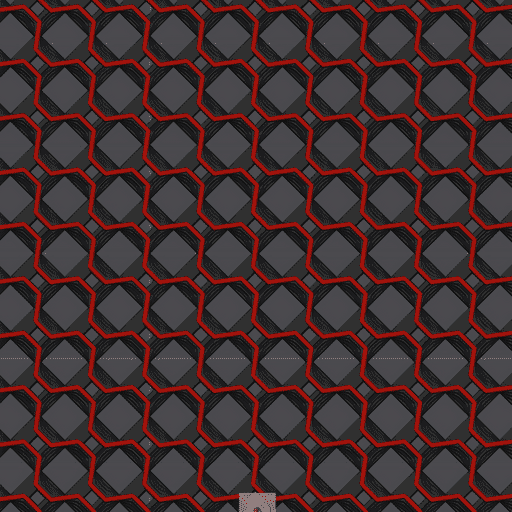

# infill_shift_step

> Location: Process → Strength → Infill → Infill shift step

---

[Mode](../../../general_settings/option_mode.md): `Advanced`.  
[Variable](../../../developer_reference/built_in_placeholders_variables.md): `infill_shift_step`.  
[Type](../../../general_settings/option_type.md#integer-float-percentage): `Float`.  
[Default](../../../general_settings/option_type.md#default-value): `0.4`.  
[Unit](../../../general_settings/option_type.md#unit): `mm`.  
[Range](../../../general_settings/option_type.md#range): `[0, 10]`.  
[CLI Example](../../../cli/cli_mode.md#setting-overrides): `--infill-shift-step=1`.  

This parameter adds a slight displacement to each layer of infill to create a cross texture.

## Cross Hatch

Similar to [Gyroid](#gyroid) but with linear patterns, creating weak points at internal corners.
Easier to slice but consider using [TPMS-D](#tpms-d) or [Gyroid](#gyroid) for better strength and flexibility.

- **Strength**
    - **Horizontal (X-Y):** Normal-High 
    - **Vertical (Z):** Normal-High 
- **Density Calculation:**  % of  total infill volume
    - **Material Usage:** Normal 
    - **Print Time:** Normal-High 
        - **Material/Time (Higher better):** Normal-Low 
        - **Layer time Variability:** Likely Noticeable
    - **Slicing Time:** Normal 
    - **G-code Size:** Normal 
- **Extra:**
    - **[Multiline](../../process/strength/fill_multiline.md):** [Classic](../../process/strength/sparse_infill_pattern.md)
        - **2 lines:** Print Time Normal  (12% Faster over single line)
        - **3 lines:** Print Time Normal-Low  (18% Faster over single line)
    - **[Symmetric infill Y axis](../../process/strength/symmetric_infill_y_axis.md):** No
    - **[Smooth Factor](../../process/strength/sparse_infill_pattern.md):** Yes
- **Applies to:**
    - **[Sparse Infill](../../process/strength/sparse_infill_density.md)**

