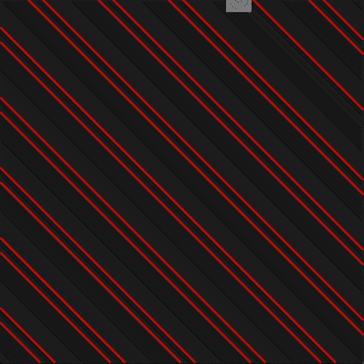

# lateral_lattice_angle_1

> Location: Process → Strength → Infill
> Also in this section: `lateral_lattice_angle_2` (each documented on its own page).

---

## Lateral Lattice

[Mode](../../../general_settings/option_mode.md): `Advanced`.  
[Variable](../../../developer_reference/built_in_placeholders_variables.md): `lateral_lattice_angle_1`.  
[Type](../../../general_settings/option_type.md#integer-float-percentage): `Float`.  
[Default](../../../general_settings/option_type.md#default-value): `-45`.  
[Range](../../../general_settings/option_type.md#range): `-75–75` °.  
[CLI Example](../../../cli/cli_mode.md#setting-overrides): `--lateral-lattice-angle-1=1`.  
Low-strength pattern with good flexibility. You can adjust **Angle 1** and **Angle 2** to optimize the infill for your specific model. Each angle sets the tilt in the Z direction of one of the two sets of lattice elements. 0° is vertical.

- **Strength**
    - **Horizontal (X-Y):** Normal-Low 
    - **Vertical (Z):** Low 
- **Density Calculation:**  % of  total infill volume
    - **Material Usage:** Normal 
    - **Print Time:** Normal-Low 
        - **Material/Time (Higher better):** Normal-High 
        - **Layer time Variability:** Unnoticeable
    - **Slicing Time:** Normal-Low 
    - **G-code Size:** Extra-Low 
- **Extra:**
    - **[Multiline](../../process/strength/fill_multiline.md):** [Classic](../../process/strength/sparse_infill_pattern.md)
        - **2 lines:** Print Time Low  (8% Faster over single line)
        - **3 lines:** Print Time Low  (10% Faster over single line)
    - **[Symmetric infill Y axis](../../process/strength/symmetric_infill_y_axis.md):** No
    - **[Smooth Factor](../../process/strength/sparse_infill_pattern.md):** No
- **Applies to:**
    - **[Sparse Infill](../../process/strength/sparse_infill_density.md)**

