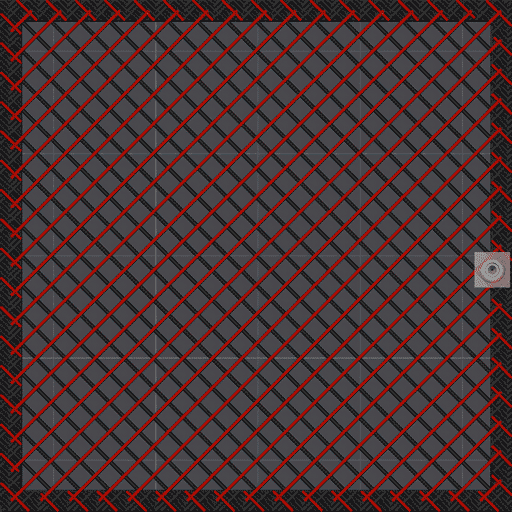

# skeleton_infill_line_width

> Location: Process → Strength → Infill
> Also in this section: `skin_infill_density`, `skeleton_infill_density`, `infill_lock_depth`, `skin_infill_depth`, `skin_infill_line_width` (each documented on its own page).

---

## Locked Zag

[Mode](../../../general_settings/option_mode.md): `Advanced`.  
[Variable](../../../developer_reference/built_in_placeholders_variables.md): `skeleton_infill_line_width`.  
[Type](../../../general_settings/option_type.md): Float or Percentage.  
[Default](../../../general_settings/option_type.md#default-value): `100%`.  
[Range](../../../general_settings/option_type.md#range): `≥ 0` mm.  
[CLI Example](../../../cli/cli_mode.md#setting-overrides): `--skeleton-infill-line-width=1`.  
Version of [Zig Zag](#zig-zag) that adds extra skin.
When using this fill, you can individually modify the density of the skeleton and skin, as well as the size of the skin and how much interconnection there is between the skin and the skeleton (a lock depth of 50% of the skin depth is recommended).  
**Skin line width** and **Skeleton line width** set the line width of the skin and skeleton paths. If expressed as a %, they are computed over the nozzle diameter.  
The **Infill shift step** of [Cross Zag](#cross-zag) also applies to Locked Zag, but it only shifts the skin. The skeleton is not shifted.

- **Strength**
    - **Horizontal (X-Y):** Normal-Low 
    - **Vertical (Z):** Normal-Low 
- **Density Calculation:** Similar to [Zig Zag](#zig-zag).
Skeleton density * (Infill area - Skin area + Lock depth area) + (Skin density * Skin area).
    - **Material Usage:** Ultra-High 
    - **Print Time:** Extra-High 
        - **Material/Time (Higher better):** Normal 
        - **Layer time Variability:** None
    - **Slicing Time:** Normal 
    - **G-code Size:** Normal-High 
- **Extra:**
    - **[Multiline](../../process/strength/fill_multiline.md):** No
    - **[Symmetric infill Y axis](../../process/strength/symmetric_infill_y_axis.md):** Yes
    - **[Smooth Factor](../../process/strength/sparse_infill_pattern.md):** No
- **Applies to:**
    - **[Sparse Infill](../../process/strength/sparse_infill_density.md)**

