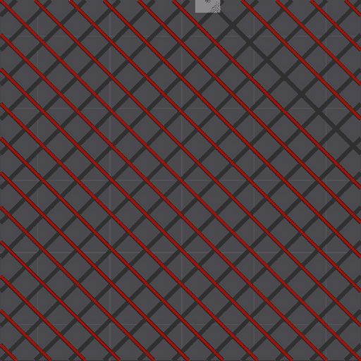

# symmetric_infill_y_axis

> Location: Process → Strength → Infill → Symmetric infill Y axis

---

[Mode](../../../general_settings/option_mode.md): `Advanced`.  
[Variable](../../../developer_reference/built_in_placeholders_variables.md): `symmetric_infill_y_axis`.  
[Type](../../../general_settings/option_type.md#boolean): `Boolean`.  
[Default](../../../general_settings/option_type.md#default-value): `false`.  
[CLI Example](../../../cli/cli_mode.md#setting-overrides): `--symmetric-infill-y-axis=1`.  

If the model has two parts that are symmetric about the Y axis, and you want these parts to have symmetric textures, please click this option on one of the parts.

## Zig Zag

Similar to rectilinear, with a consistent pattern between layers.

- **Strength**
    - **Horizontal (X-Y):** Normal-Low 
    - **Vertical (Z):** Low 
- **Density Calculation:**  % of  total infill volume
    - **Material Usage:** Normal 
    - **Print Time:** Normal-Low 
        - **Material/Time (Higher better):** Normal-High 
        - **Layer time Variability:** None
    - **Slicing Time:** Normal-Low 
    - **G-code Size:** Extra-Low 
- **Extra:**
    - **[Multiline](../../process/strength/fill_multiline.md):** No
    - **[Symmetric infill Y axis](../../process/strength/symmetric_infill_y_axis.md):** Yes
    - **[Smooth Factor](../../process/strength/sparse_infill_pattern.md):** No
- **Applies to:**
    - **[Sparse Infill](../../process/strength/sparse_infill_density.md)**

